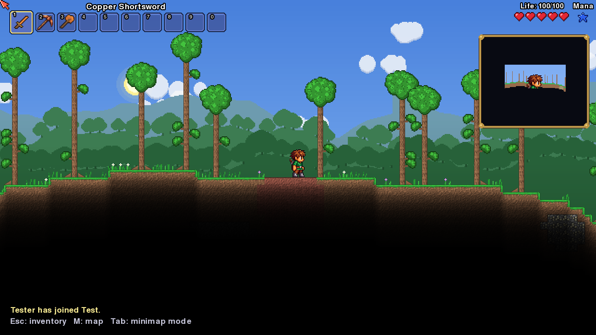
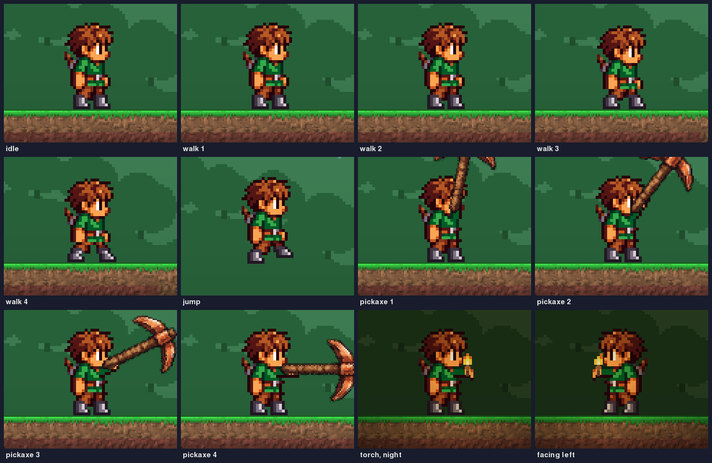

# Pyraria

A Terraria-style 2D sandbox written in Python (pygame + numpy). It generates a
Terraria-like **Corruption world** and gives you the full core game loop:
health, mana, breath, inventory, equipment, crafting, chests, the map and so on.
As requested, the world is **empty**: no enemies, bosses, NPCs, loot chests,
pots or other pre-placed items.

All graphics and sounds are generated procedurally at start-up. No Terraria
assets are included, and this project is not affiliated with Re-Logic.



## ▶ Play in your browser

**https://revylox.github.io/pyraria/**

The page shows a loading screen, then asks for one click to start (browsers
need that before they allow sound). The web version runs the same game
through [pygbag](https://github.com/pygame-web/pygbag) (Python compiled to
WebAssembly), so it's slower than the desktop version. Worlds are limited to
Small and Medium, and saves are kept in the browser's local storage.
Every push to `main` rebuilds and republishes the page automatically (see
`.github/workflows/web.yml`).

## Running

**Easiest:** unzip, then
- **Windows:** double-click `play_windows.bat`
- **macOS / Linux:** run `./play_mac_linux.sh` in a terminal

You need [Python 3.9+](https://www.python.org/downloads/) installed (on
Windows, tick "Add python.exe to PATH"). The first launch sets up a private
`.venv` folder and downloads pygame-ce and numpy, so it needs internet once.
Later launches start straight away.

**Manual alternative:**

```bash
python -m pip install -r requirements.txt
python main.py
```

You need Python 3.9 or newer. `pygame-ce` is recommended; classic `pygame`
2.5 and later also works.

Title screen → **Single Player** → create a player → create a world (Small,
Medium or Large, with an optional seed). Worlds take about 4, 15 and 30 seconds
to generate. Saves go to `saves/`.

## Controls

| Action | Key |
|---|---|
| Move / jump | `A` `D` / `Space` (or `W`, arrow keys) |
| Drop through platforms | `S` |
| Use item (mine, chop, place, swing) | Left mouse (hold to keep going) |
| Interact (doors, chests) | Right mouse |
| Inventory | `Esc` |
| Select hotbar slot | `1`–`0`, mouse wheel |
| Fullscreen map | `M` (drag to pan, wheel to zoom) |
| Minimap mode (frame / overlay / off) | `Tab`, zoom with `+` / `-` |
| Throw held item | `T` |
| Chat | `Enter` |
| FPS / position display | `F10` |
| Fullscreen | `F11` |

Inventory: left-click picks up or places, right-click (hold) splits off one
item at a time, `Shift`-click quick-moves (to and from a chest, equips gear,
hotbar ↔ bag), and `Ctrl`-click sends an item to the trash.

## Features

**World generation (Corruption world)**
- Oceans and beaches on both sides, forest spawn, hills and mountains,
  surface and underground caves, the dirt layer and the cavern layer.
- Two Corruption patches with ebonstone, purple grass, ebonwood trees, deep
  **chasms**, demonite and demon altars.
- Snow/ice biome, underground desert (sand, hardened sand, sandstone),
  jungle down to the underworld, glowing-mushroom caves, floating islands,
  the dungeon (blue bricks), and the underworld (ash, hellstone, lava sea).
- Ores in Terraria's random pairs (copper/tin, iron/lead, silver/tungsten,
  gold/platinum), plus water and lava pools, trees, cacti, palms, grass and
  vines.

**Simulation**
- Terraria movement physics: acceleration, held jumps, step-up, platforms,
  swimming, low gravity in space and fall damage.
- Mining with pickaxe power and tile hardness, axes for trees, hammers for
  walls, block, wall, torch and furniture placement, falling sand, and
  flowing water and lava (they make obsidian when they meet).
- Grass spreading, slow Corruption spread, plant regrowth, and acorn saplings
  that grow into trees.
- Day/night cycle using Terraria's timings, coloured smooth lighting (or
  "Retro" blocky lighting), torches, lava glow, and glowing mushrooms.
- Lighting follows Terraria's rules: light fades by 0.91 per tile through
  air, 0.56 through solid blocks, and loses red faster than blue in water.
  Faces of blocks touching light are fully lit, glass lets light through,
  and a torch held in the hand or lying on the ground lights up its
  surroundings. Torch flames are animated (each torch flickers on its own)
  and give off glowing embers.

**Player and UI**
- Life with hearts and regeneration, mana stars, breath bubbles, the
  "On Fire!" debuff, defense, death and respawn.
- 50-slot inventory with hotbar, coins, ammo, trash and sorting.
- Equipment: 3 armour, 3 vanity, 3 dye and 5 accessory slots (with
  visibility toggles), plus a Misc page (pet, light pet, minecart, mount,
  hook, dyes).
- Crafting by hand, at a Work Bench or at a Furnace. Chests with Loot All,
  Deposit All, Quick Stack and Sort.
- Minimap (frame or overlay), fullscreen map with fog of war, item tooltips,
  pickup text, chat and an in-game settings menu.
- Parallax backgrounds for each biome, an underground backdrop, sun, moon,
  stars and clouds.

**The hero.** Every character uses the same hand-drawn hero sprite
(`pyraria/sprites/player.png`). Its walk, jump and arm-swing frames are
made from that one picture. The Copper Pickaxe uses its own sprite
(`pyraria/sprites/copper_pickaxe.png`).



## About the "empty" world

- No enemies, bosses, NPCs, chests, pots, life crystals or other loot.
- You start with Terraria's default kit: Copper Shortsword, Pickaxe and Axe.
  Without a pickaxe nothing could be mined. Set `STARTER_KIT = False` in
  `pyraria/config.py` for a truly empty start.
- A few basic recipes exist so building works: Work Bench, platforms, torches,
  door, chest, furnace, walls, bricks, glass and bars. In Terraria, torches
  need Gel from slimes. There are no slimes, so here **1 Wood → 3 Torches**.
- Block hardness follows Terraria. Ebonstone, hellstone and dungeon bricks
  need a stronger pickaxe than copper, as in the real game.
- The item system already supports armour, accessories, vanity, dyes, coins,
  ammo and misc equipment. Add an `ItemDef` in `pyraria/items.py` with
  `equip="head"` (or `body`, `legs`, `accessory`, ...) and a `defense` value,
  and the slots and defense stat pick it up.

## Project layout

| File | Purpose |
|---|---|
| `main.py` | entry point |
| `pyraria/app.py` | window, main loop, state switching |
| `pyraria/menus.py` | title, player/world select and create, generation screen |
| `pyraria/game.py` | in-game loop: input, simulation, camera, drawing |
| `pyraria/worldgen.py` | world generator |
| `pyraria/world.py` | tile/wall/liquid data, liquid simulation, saving |
| `pyraria/tiles.py`, `items.py`, `inventory.py` | content definitions |
| `pyraria/player.py`, `playergfx.py` | player physics, item use, character animation |
| `pyraria/sprites/` | hero and Copper Pickaxe sprites |
| `pyraria/renderer.py`, `lighting.py`, `background.py` | rendering |
| `pyraria/terrain_tex.py`, `textures.py` | procedural pixel art |
| `pyraria/ui.py`, `minimap.py`, `text.py`, `audio.py` | HUD, map, fonts, sound |
| `pyraria/sounds/` | sound effect files (door and menu open/close, menu hover tick, sword swings; `.wav` for desktop, `.ogg` for the web build) |
